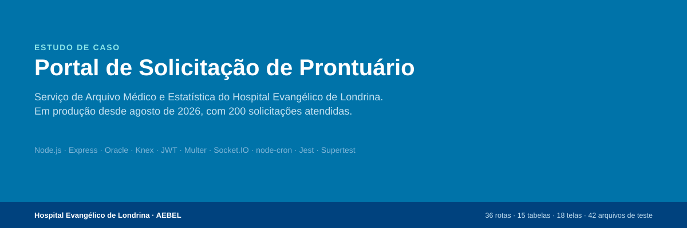
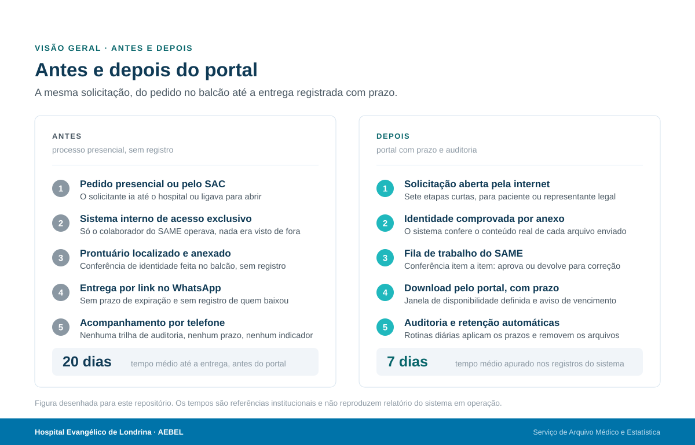
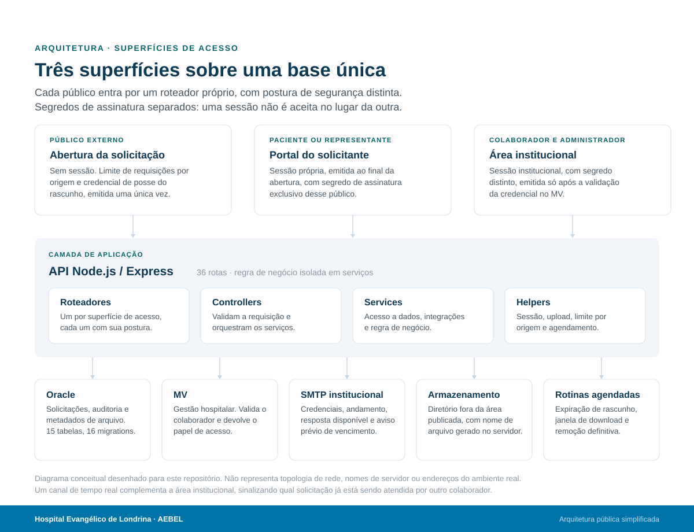
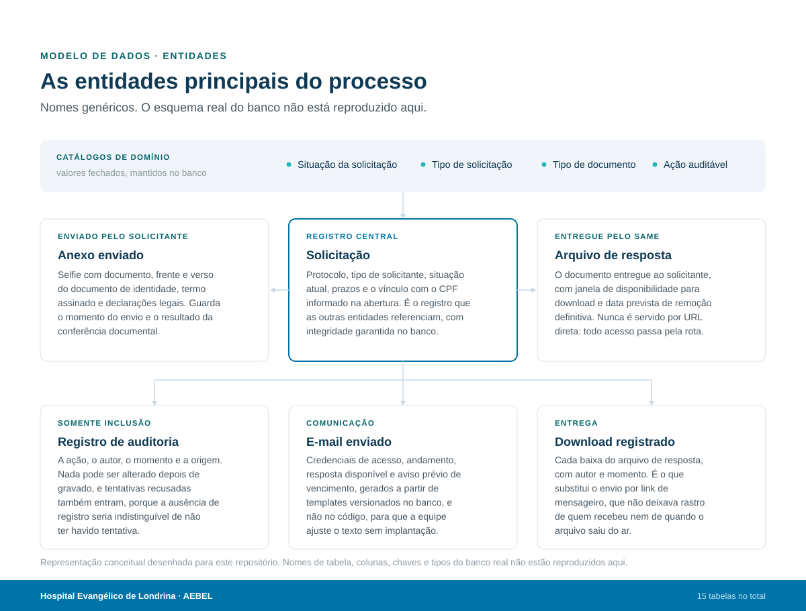
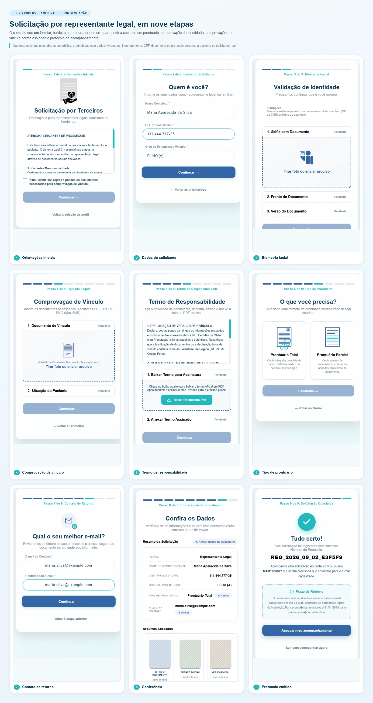

# Portal de Solicitação de Prontuário - SAME

Estudo de caso do sistema que transformou a solicitação de prontuário médico do
**Hospital Evangélico de Londrina (AEBEL)** em um fluxo digital, rastreável e com prazo
controlado, substituindo um processo presencial cuja entrega final acontecia por link de
WhatsApp.

Este repositório **não contém código-fonte, esquema de banco real, endpoints ou
configuração do sistema em operação**. É um relato de projeto: o problema, a decisão
técnica, o que foi construído e o que mudou depois. Todos os diagramas foram desenhados
para este documento e todos os dados exibidos são fictícios.

---

## Em resumo

| Item | Descrição |
|---|---|
| Contexto | Serviço de Arquivo Médico e Estatística (SAME) do Hospital Evangélico de Londrina - AEBEL |
| Período | Julho a agosto de 2026 - especificação funcional em 14/07, início do desenvolvimento em 24/07, entrada em produção em agosto |
| Papel | Desenvolvedor responsável pelo sistema: modelagem de dados, backend, frontend, integração institucional e implantação |
| Usuários | Pacientes e representantes legais (público externo, sem cadastro prévio) e 3 usuários institucionais do SAME |
| Situação | **Em produção** desde agosto de 2026 |
| Tecnologias | Node.js, Express, Oracle (via Knex), JWT, Multer, Socket.IO, node-cron, Jest e Supertest; interface em HTML, CSS e JavaScript sem framework |
| Volume construído | 36 rotas em 3 superfícies de acesso, 15 tabelas, 18 telas, 42 arquivos de teste automatizado |
| Volume atendido | 200 solicitações desde a entrada em produção |

---

## O que estava quebrado

Cópia de prontuário é um documento que a pessoa quase sempre precisa sob pressão: perícia
do INSS, continuidade de tratamento em outro serviço, processo judicial. O pedido chegava
ao hospital de forma presencial ou pelo SAC.

O fluxo anterior era institucional apenas de um lado. O colaborador do SAME operava um
sistema interno ao qual só ele tinha acesso, localizava o prontuário, anexava o arquivo e
**entregava ao solicitante por meio de um link enviado no WhatsApp**. O solicitante não
tinha onde acompanhar nada: ligava para saber do andamento, ou voltava ao hospital.

O que esse desenho custava:

- **Deslocamento desnecessário.** Abrir o pedido exigia presença física ou uma ligação; a
  correção de um documento ilegível exigia outra.
- **Entrega por canal não institucional.** O arquivo com dado clínico saía por uma
  ferramenta pessoal, sem prazo de expiração, sem controle de quem baixou e sem registro
  de que a entrega ocorreu.
- **Nenhuma trilha de auditoria.** Não havia registro estruturado de quem analisou, quando
  aprovou, por que recusou um documento ou quando a resposta foi liberada.
- **Nenhuma retenção definida.** Os documentos de identificação enviados pelo solicitante
  ficavam onde tivessem sido recebidos, sem prazo para sair de lá.
- **Nenhum indicador.** Não existia número de fila, tempo médio de resposta ou volume por
  período, a gestão do serviço era feita por percepção.
- **Prazo longo.** O tempo médio entre o pedido e a entrega era de cerca de **20 dias**.

---

## O que foi construído

Um portal em que o solicitante abre o pedido pela internet, comprova identidade por
anexo, acompanha o andamento por login próprio e baixa o prontuário dentro de um prazo
determinado, enquanto a equipe do SAME trabalha sobre uma fila com filtros, conferência
documental item a item, indicadores e trilha de auditoria.



O sistema se organiza em **três superfícies de acesso com posturas de segurança
deliberadamente distintas**, e essa é a decisão estrutural do projeto:

- **Abertura da solicitação sem autenticação.** Não teria como ser diferente: o
  solicitante ainda não tem cadastro. A etapa é protegida por limite de requisições por
  origem e por um protocolo imprevisível, que funciona como credencial de posse daquele
  rascunho.
- **Portal do solicitante com sessão própria.** Credenciais geradas e enviadas por e-mail ao
  final da abertura, com troca de senha obrigatória no primeiro acesso. Cada consulta
  reconfere o vínculo: o solicitante enxerga apenas as próprias solicitações.
- **Área institucional - identidade do MV.** O colaborador entra com a mesma matrícula que
  já usa no sistema de gestão hospitalar. O portal **não cria login novo nem armazena
  senha institucional**: valida no MV e lê o papel autorizado de lá.

A jornada foi desenhada em etapas curtas, porque o público inclui pessoas com pouca
familiaridade com sistemas digitais: identificação, envio da selfie com documento, termo
de consentimento assinado, escolha do documento e uma conferência final que devolve
**tudo o que falta de uma só vez**, em vez de revelar uma pendência por vez.

Do lado institucional, recusar um documento é diferente de cancelar a solicitação. A
recusa devolve o pedido ao solicitante indicando exatamente o que reenviar; assim que não
resta pendência, ele volta sozinho para a fila. O cancelamento encerra o caso com
justificativa registrada.

Prazos e retenção deixaram de depender de alguém lembrar: rotinas diárias aplicam o prazo
de resposta, a janela de download, o aviso de vencimento e a remoção dos arquivos quando o
prazo termina.

---

## Onde eu atuei

- **Modelagem do banco de dados** em 15 tabelas com catálogos de situação, tipo de
  documento e ação auditável, evoluída em 16 migrations versionadas e numeradas.
- **Backend completo** em Node.js e Express sobre Oracle: 36 rotas divididas em três
  roteadores, um por superfície de acesso, com regra de negócio isolada em camada de
  serviço.
- **Integração com o banco de dados do MV** para autenticação institucional por papel, eliminando a criação
  de um cadastro paralelo de colaboradores.
- **Trilha de auditoria somente-inclusão**, imposta no próprio banco: nenhum registro pode
  ser alterado depois de gravado, nem para conserto. Inclui tentativas de acesso que
  falharam.
- **Interface completa em 18 telas**, sem framework, seguindo a identidade visual
  institucional: fluxo público em etapas, portal do solicitante e painel administrativo,
  com as tabelas se reorganizando em cards no celular.
- **Camada de proteção de arquivos**: validação do conteúdo real do anexo pelos bytes
  iniciais em vez da extensão, nome de arquivo gerado pelo servidor, armazenamento fora da
  área publicada e limite de requisições por origem em toda superfície pública.
- **Rotinas agendadas de ciclo de vida** para expiração de rascunho, janela de download,
  aviso prévio de vencimento e remoção definitiva, reconciliando disco contra banco.
- **Documentação de entrega**: especificação funcional, contrato OpenAPI das rotas, manual
  do paciente e manual do colaborador.
- **Auditoria técnica do próprio código** antes da implantação, revisando bugs, casos de
  borda e segurança, o achado de maior impacto foi uma configuração de proxy reverso que
  anulava silenciosamente os limitadores de requisição e gravava sempre o mesmo endereço
  de origem na auditoria.

---

## O que mudou depois

- **O tempo médio de atendimento caiu de cerca de 20 dias para 7 dias corridos**, uma
  redução de aproximadamente 65%.
- **200 solicitações atendidas** pelo canal digital desde a entrada em produção, em agosto
  de 2026.
- **A entrega saiu do WhatsApp.** O prontuário passou a ser baixado pelo portal, dentro de
  uma janela de disponibilidade definida, com registro de cada download.
- **O processo passou a ser auditável de ponta a ponta.** Quem fez, o quê, quando e de
  qual origem, informação que simplesmente não existia antes.
- **A retenção de dados pessoais passou a ter prazo.** Selfie e documento de identidade
  existem apenas para confirmar identidade e são removidos ao fim do prazo; não se
  acumulam como base de imagens.
- **A operação cabe em 3 pessoas.** A fila com filtros, conferência item a item e
  indicadores permitiu que o serviço fosse conduzido pela equipe existente do SAME, sem
  reforço de pessoal.

> **Ressalva metodológica.** O tempo de 20 dias do processo anterior é uma referência
> institucional: não havia instrumentação que o medisse formalmente, justamente porque a
> ausência de indicadores era parte do problema. O tempo de 7 dias corridos é apurado
> sobre os registros do sistema atual. A comparação indica ordem de grandeza da mudança,
> não um resultado obtido sob medição controlada.

---

## Como o sistema está organizado



O detalhamento das camadas, do isolamento entre superfícies e do modelo de dados está em
[`ANALISE-TECNICA.md`](ANALISE-TECNICA.md) e em [`registro/01-arquitetura.md`](registro/01-arquitetura.md). A
postura de retenção, auditoria e proteção de dados está em
[`registro/02-protecao-de-dados.md`](registro/02-protecao-de-dados.md), e o registro das escolhas de
projeto cada uma com o custo que ela impôs em
[`registro/03-escolhas-e-custos.md`](registro/03-escolhas-e-custos.md).



---

## Interfaces

O fluxo de solicitação é aberto ao público, então as telas abaixo são **capturas reais**,
feitas no ambiente de homologação e preenchidas com dados inventados. São as nove etapas
do caminho mais exigente, o do representante legal que pede o prontuário de um terceiro:



As telas de colaborador e de administrador não podem ser divulgadas. A fila de trabalho do
SAME aparece aqui **recriada**: reproduz a estrutura e a identidade visual da interface,
com conteúdo inteiramente fictício.


---

## Mapa do repositório

```text
.
├── README.md                        O case: problema, solução e resultado
├── analise-tecnica.md               Decisões, trade-offs e o que eu faria diferente
├── midia/
│   ├── abertura.svg
│   ├── antes-e-depois.svg           O processo anterior ao lado do processo digital
│   ├── mapa-do-sistema.svg          Superfícies de acesso e integrações
│   ├── entidades.svg                Entidades principais, em nomes genéricos
│   └── interfaces/
│       ├── publico/                 Capturas reais do fluxo público, dados inventados
│       └── fila-operacional.svg     Tela restrita, recriada com dados fictícios
├── registro/
│   ├── 01-arquitetura.md            Camadas, superfícies de acesso e integrações
│   ├── 02-protecao-de-dados.md      Retenção, auditoria e proteção de dado sensível
│   ├── 03-escolhas-e-custos.md      Cada decisão de projeto e o preço que ela cobrou
│   └── 04-limites-de-divulgacao.md  O que este repositório deliberadamente não contém
└── amostras/
    ├── solicitacao.sample.json      Formato de uma solicitação, com dados inventados
    └── auditoria.sample.json        Formato de uma trilha somente-inclusão, inventada
```

As duas amostras, [`solicitacao.sample.json`](amostras/solicitacao.sample.json) e
[`auditoria.sample.json`](amostras/auditoria.sample.json), ilustram o vocabulário do
domínio e o formato de uma trilha somente-inclusão. São inventados: não reproduzem o
contrato da API nem o esquema do banco.

---

## Quem participou

O projeto foi conduzido dentro da equipe de Tecnologia da Informação da AEBEL.
**Diego Silvino** contribuiu com desenvolvimento e apoio técnico ao longo da construção,
**Pedro Porto** atuou como desenvolvedor revisor, avaliando a especificação e as decisões
de implementação e **Johanna Wilhelm** auxiliou também no processo de levantamento de requisições do projeto. 
A concepção do processo e a validação funcional envolveram a equipe do SAME e a área de negócio do hospital.

---

## Limites de divulgação

Este repositório descreve um sistema corporativo em operação e foi montado para não
comprometê-lo. Não há aqui código-fonte, esquema real de banco, nomes de endpoint,
variáveis de ambiente, endereços de servidor, credenciais ou qualquer dado de paciente.

Os diagramas foram desenhados especificamente para este documento; as telas foram
recriadas com conteúdo fictício; os exemplos em `amostras/` são inventados e servem apenas
para ilustrar formato. A propriedade intelectual do sistema é do Hospital Evangélico de
Londrina - AEBEL.

O detalhe do que foi omitido e por quê está em
[`registro/04-limites-de-divulgacao.md`](registro/04-limites-de-divulgacao.md).